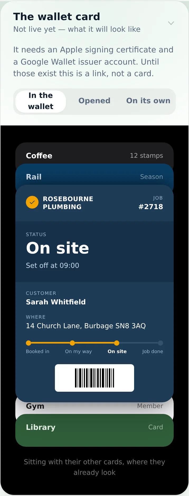
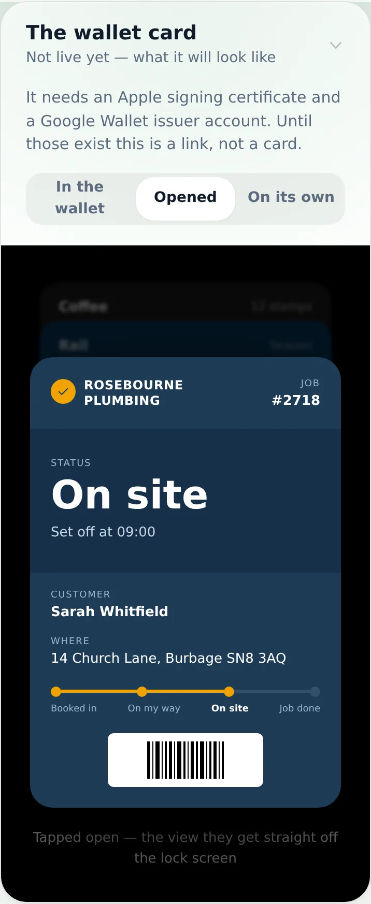
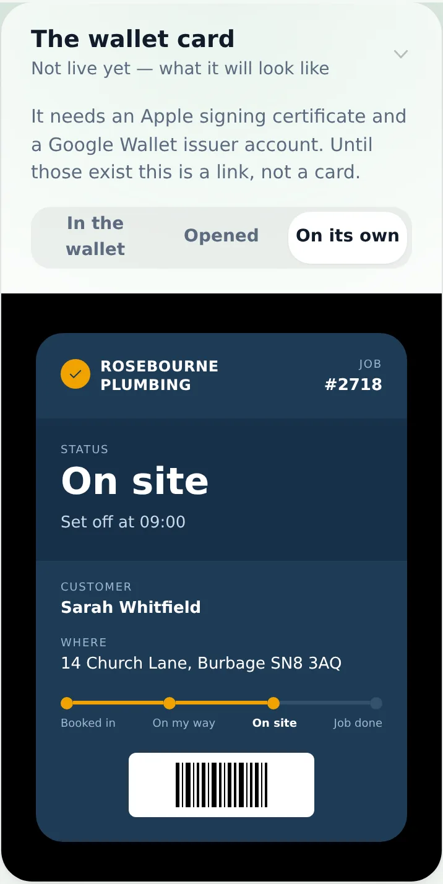
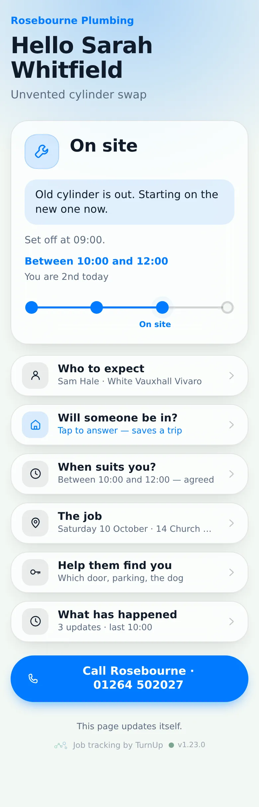
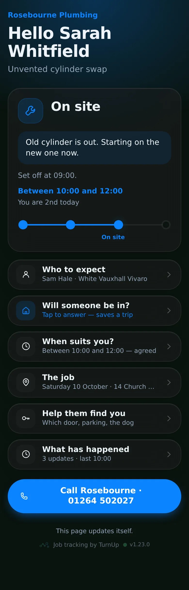
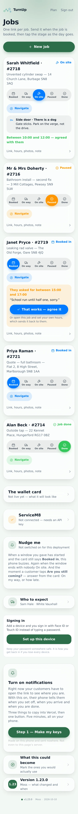
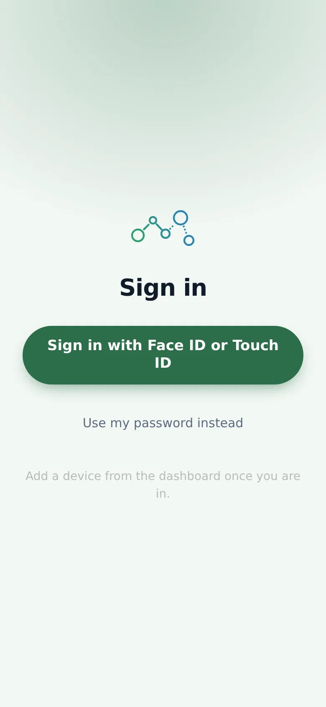

# v1.23.0 — Moss

**2026-10-10** · background `#f3f8f4` · accent `#2c6e49`

- Turn on notifications from the dashboard — no terminal, no laptop, all on your phone
- It makes the keys on your own phone and sends them nowhere, then links you straight to Vercel
- The box disappears by itself once the keys are in, which is how you know it worked

### wallet-in-stack

### wallet-opened

### wallet-alone

### customer-light

### customer-dark

### dashboard

### login

### homepage

### homepage-dark

