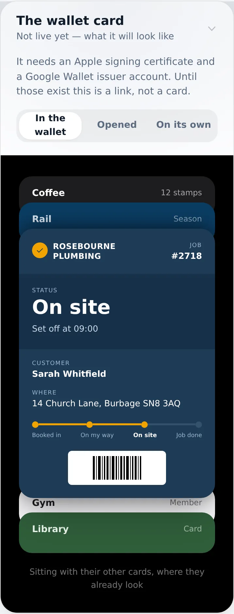
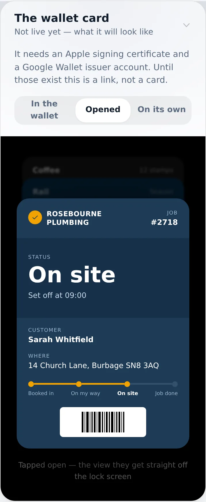
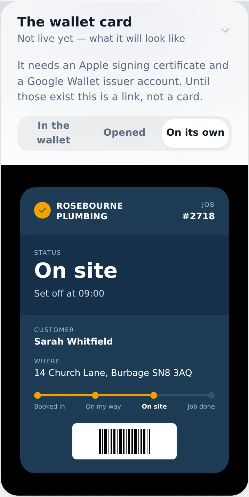
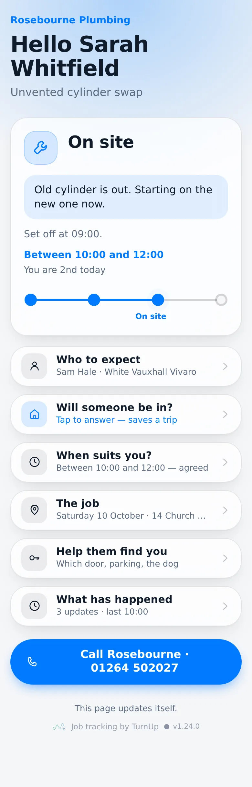
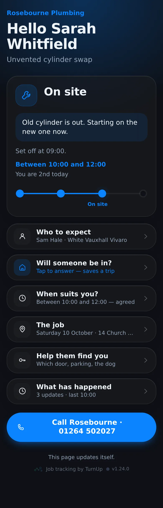
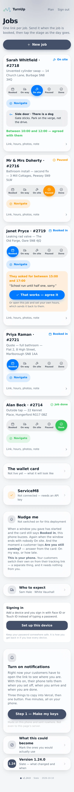
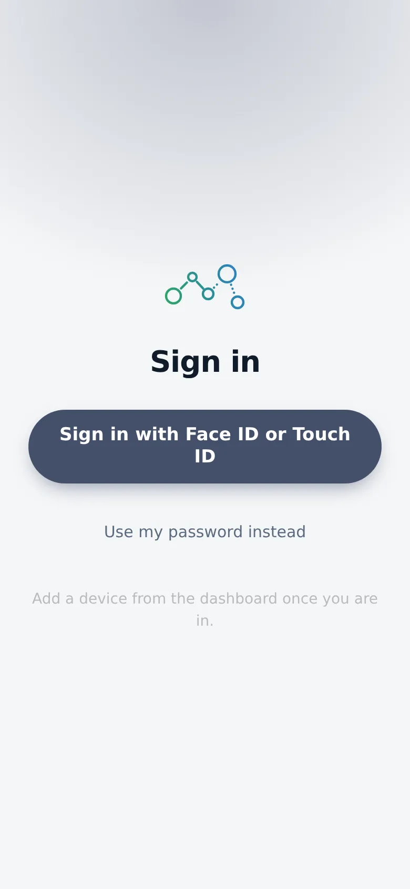

# v1.24.0 — Slate

**2026-10-10** · background `#f5f6f8` · accent `#44506b`

- Nudge me has a Send a test to this phone button — tap it, your phone buzzes, no job to move
- It says how many phones it actually reached, so nothing arriving is visible rather than silent
- Nudge me now says plainly that it is YOUR phone; customers switch their own on from their link

### wallet-in-stack

### wallet-opened

### wallet-alone

### customer-light

### customer-dark

### dashboard

### login

### homepage

### homepage-dark

