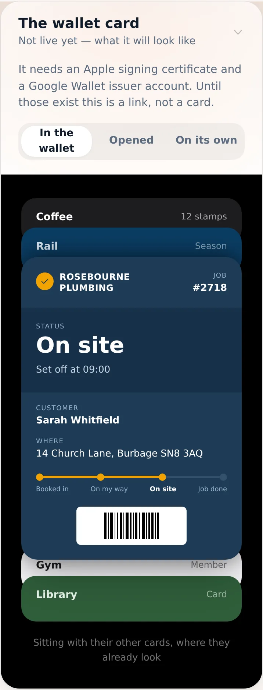
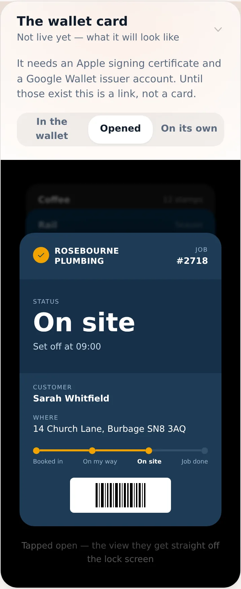
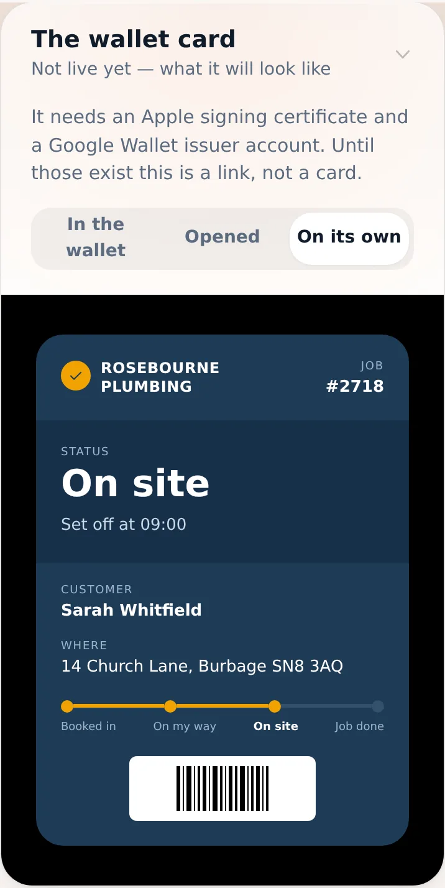
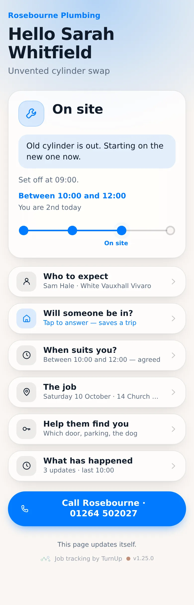
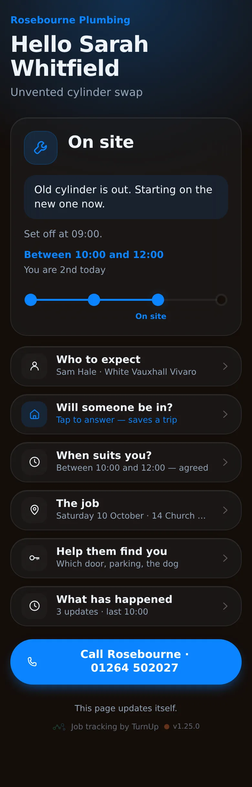
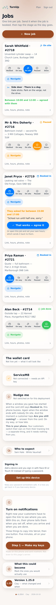
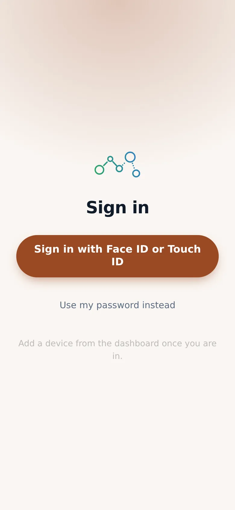

# v1.25.0 — Clay

**2026-10-10** · background `#faf6f2` · accent `#9a4a24`

- A window passing is noticed even when nobody has the page open — a scheduled check every five minutes
- Before this, nudges only ran while a customer was looking, which is the one time you do not need telling

### wallet-in-stack

### wallet-opened

### wallet-alone

### customer-light

### customer-dark

### dashboard

### login

### homepage

### homepage-dark

