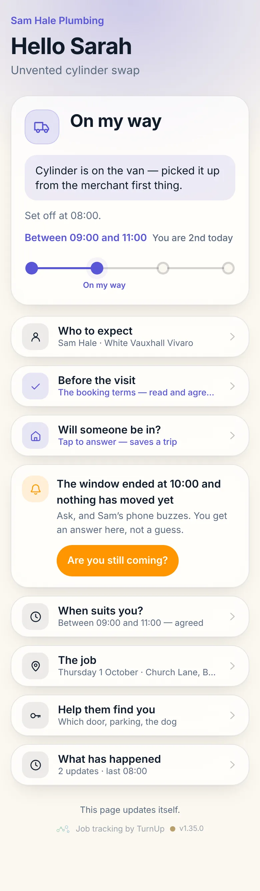
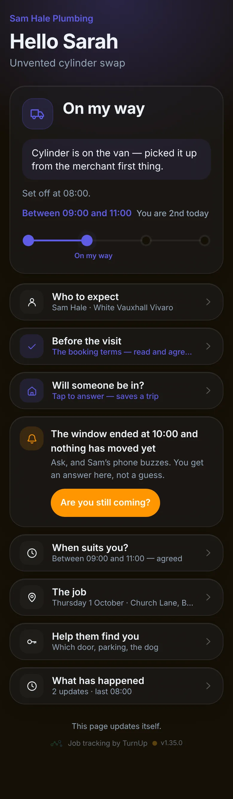
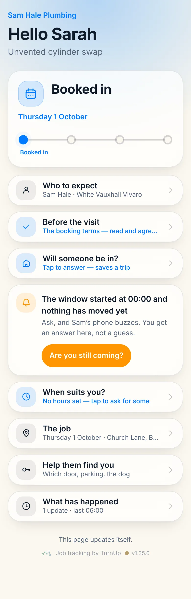
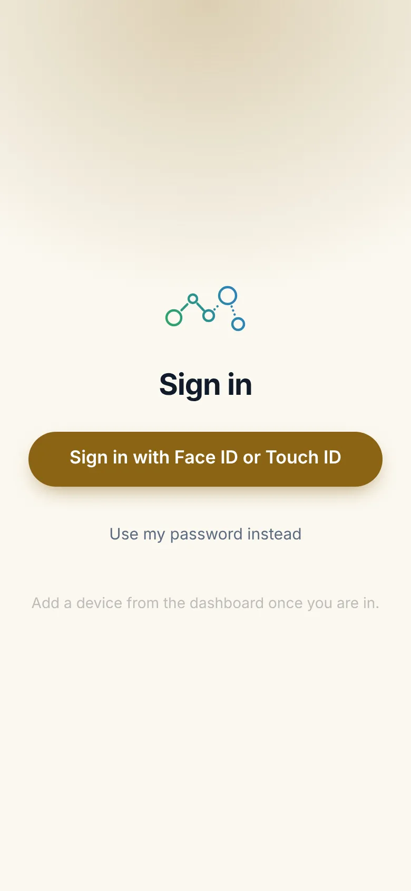

# v1.35.0 — Ochre

**2026-10-12** · background `#fbf8f0` · accent `#8a6414`

- The homepage says less and shows more. Every row the customer can open and every part of the dashboard the trade taps is now a picture of that part — cut from the real screen at 2x by scripts/capture-home-crops.mjs, never a whole phone — under a label of a few words. The paragraphs are gone; the two walkthrough strips went with them.
- The wallet card gets the section it always needed: the card pulled apart with each band named (the same bands buildPassJson signs), the same card at all four stages, its back, and the lock screen the notification lands on. Drawn from PassCard, so it cannot drift from the real pass. The badge still says it: built, waiting on Apple. The buzz on the lock screen is live today; the card updating itself in Wallet is not.
- Instead of this, with this: the “between eight and six” text beside the status card, as two panels rather than two paragraphs.

Not captured this time: the wallet views and the dashboard (they need an operator session).

### customer-light

### customer-dark

### customer-booked

### login

### homepage

### homepage-dark

