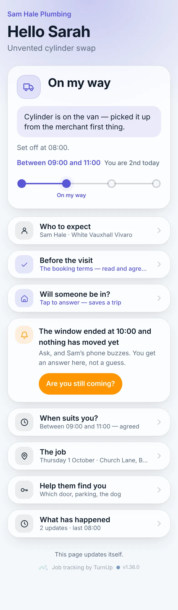
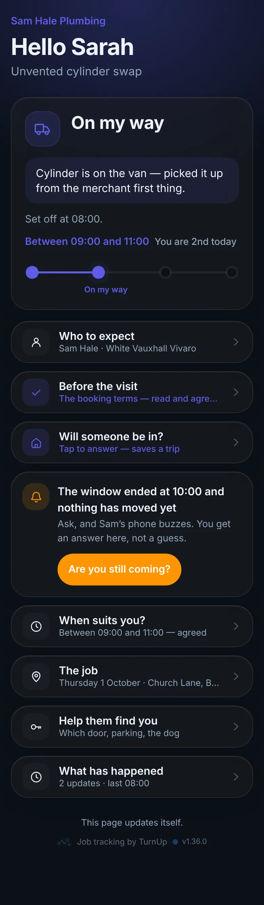
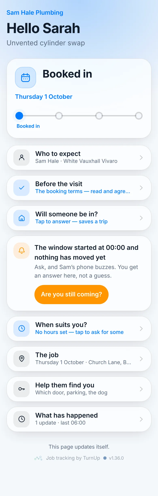
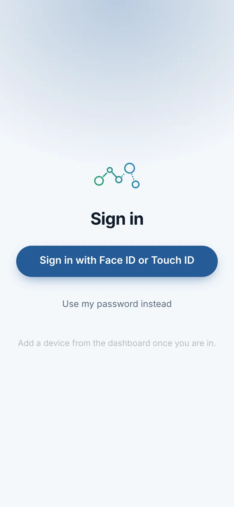

# v1.36.0 — Harbour

**2026-10-12** · background `#f4f7fb` · accent `#255a95`

- /with-servicem8 gets the homepage treatment: fewer words, and a picture of the part for every step. The customer's status card at each stage, the claim screen, the linked card and the ServiceM8 panel are cut from the existing captures (scripts/capture-home-crops.mjs, ONLY=sm8); the ServiceM8 app's four buttons and the booking text are drawn at a readable size instead of inside a 150px phone.
- What moves the card is now a row per stage: what you press, an arrow, what they see. The setup is the same four steps with the two messages to paste and a line each.
- The wallet section on the homepage, second pass at the owner's request: it opens with three phones — the lock screen, double-click, the wallet open with the card in the stack, the card tapped — so a visitor sees it is a card before anything is explained. The pulled-apart card, the four stage cards and the back now stand in three dimensions on the same dark floor as the hero, instead of lying flat.

Not captured this time: the wallet views and the dashboard (they need an operator session).

### customer-light

### customer-dark

### customer-booked

### login

### homepage

### homepage-dark

