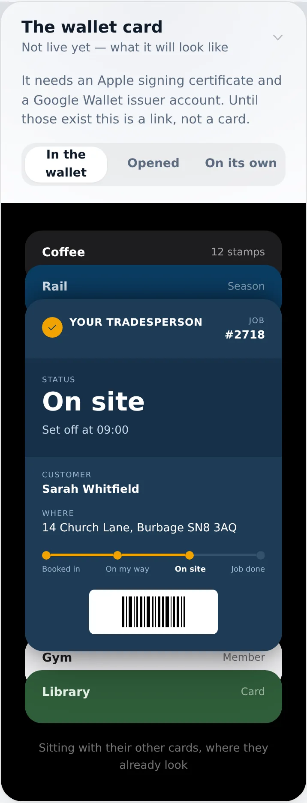
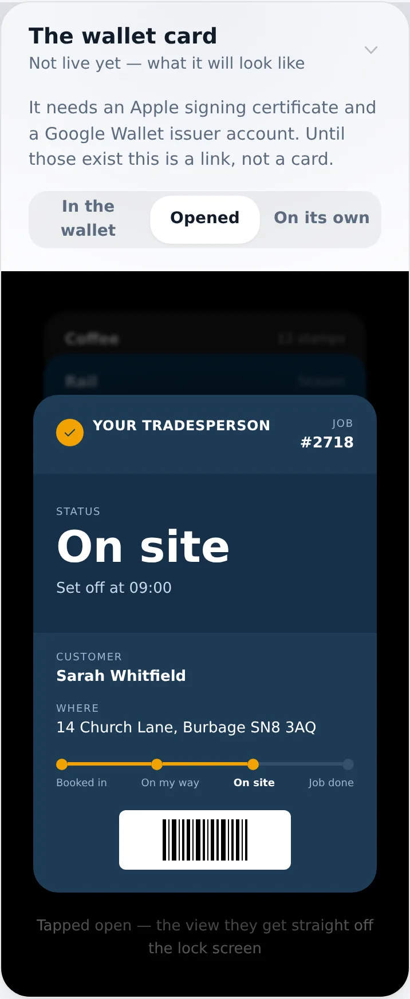
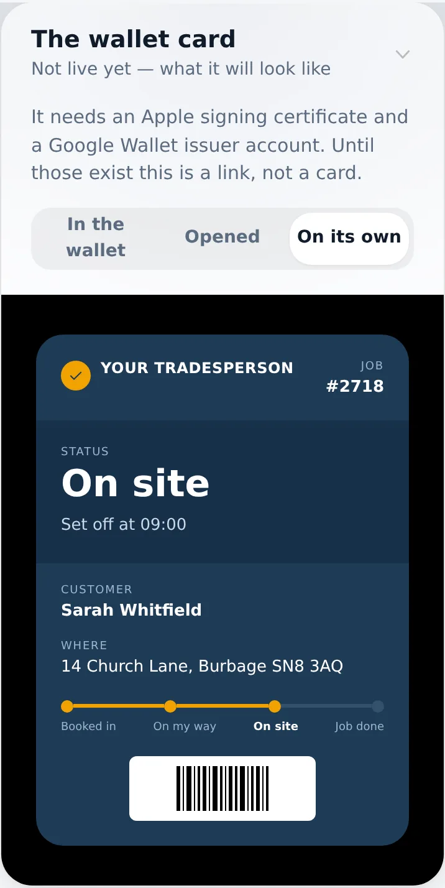
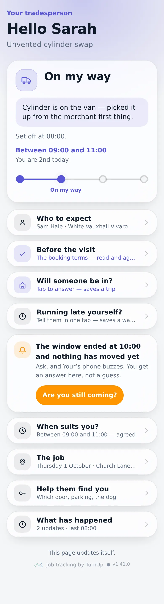
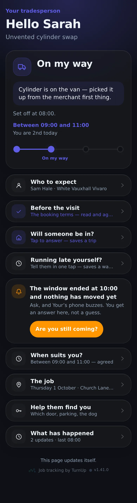
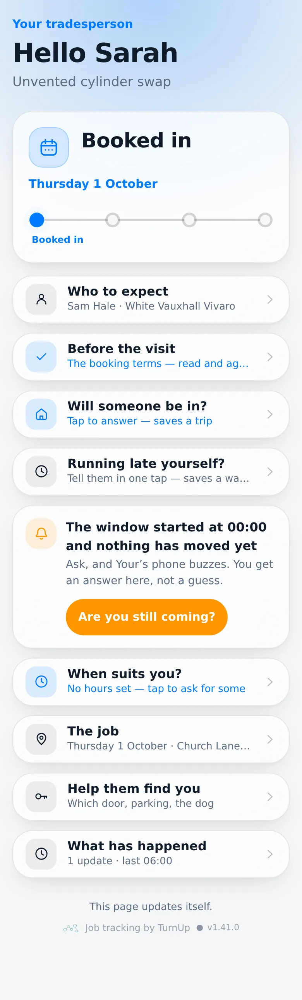
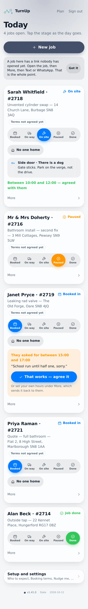
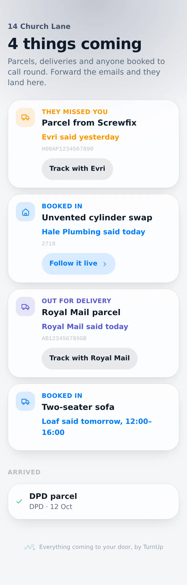
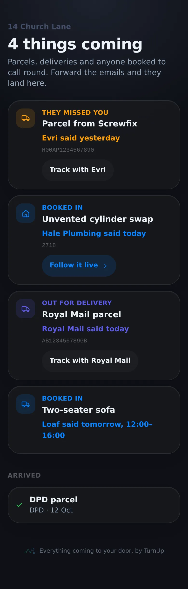

# v1.41.0 — Slate

**2026-10-12** · background `#f5f6f8` · accent `#44506b`

- The household card. One link per door, with everything coming to it on one list: your visit, the sofa, four parcels, whoever is booked to call round. A job link answers where is my plumber; this answers what is happening at my house this week, which is how the person living there already thinks about it.
- It fills itself from forwarded email. A delivery email forwarded to the card’s own address is read for who it is from, what stage it is at and what day they said — thirteen UK carriers matched on the sending domain, because a subject line can claim to be Royal Mail and a domain has to pass SPF. Anything that is not an arrival is dropped.
- The row Shop drops: a sofa with two men and a Tuesday window and no tracking number anywhere. Those emails say we will deliver and a date, so that is what is read, and the card carries them alongside the parcels.
- Every date is attributed — Evri said today, Loaf said tomorrow, 12:00–16:00. The product still never works out an arrival time; it repeats what the sender said and names them.
- Two separate secrets per card, on purpose: the link is the read half and goes to the customer, the forwarding address is the write half and goes in a mail rule. Neither is ever on the card, so a link passed round a family group chat cannot be used to post onto somebody’s door. scripts/check-public-shape.mjs now proves it.

### wallet-in-stack

### wallet-opened

### wallet-alone

### customer-light

### customer-dark

### customer-booked

### dashboard

### dashboard-setup

### login

### homepage

### homepage-dark

### household

### household-dark

