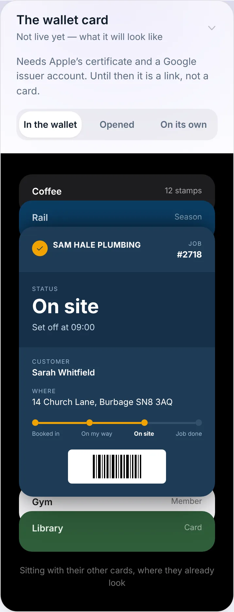
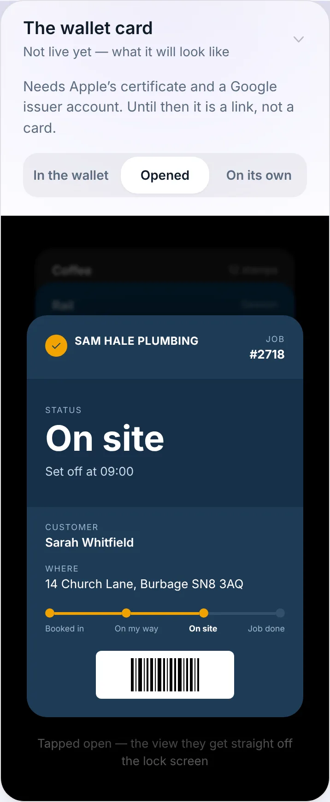
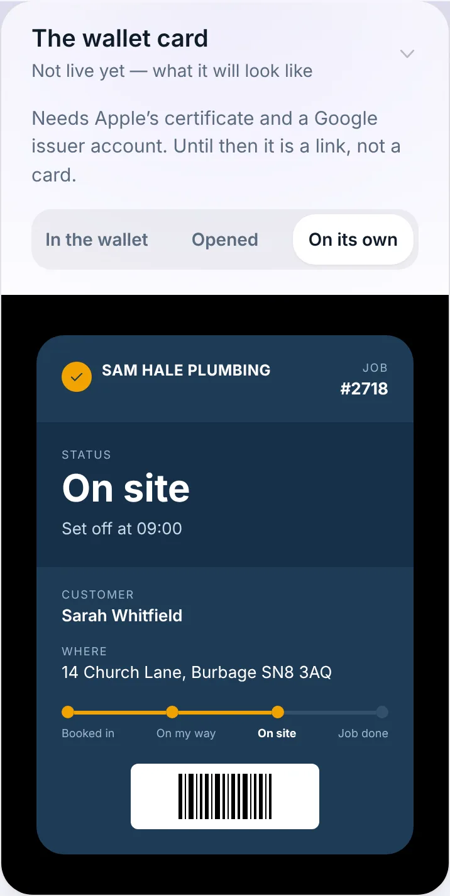
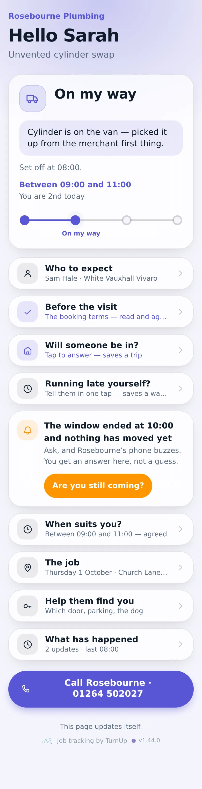
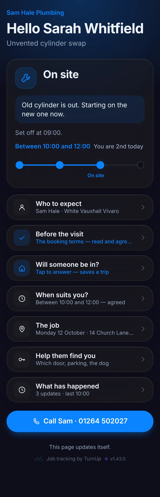
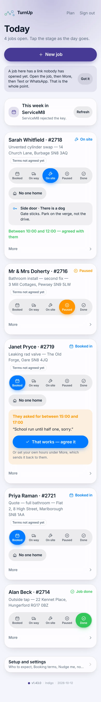
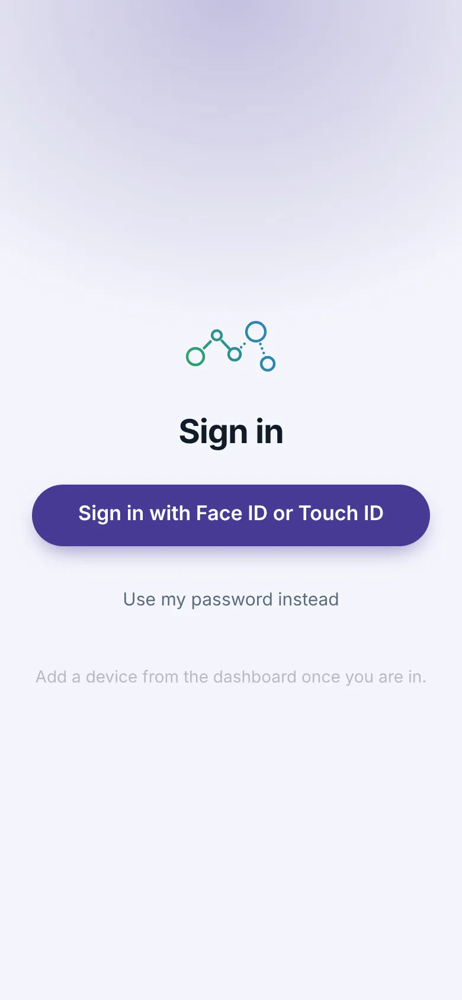
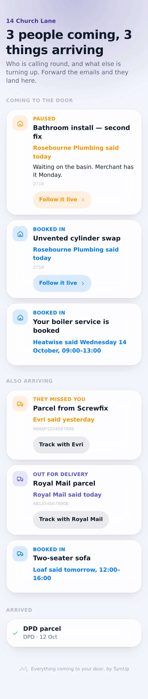
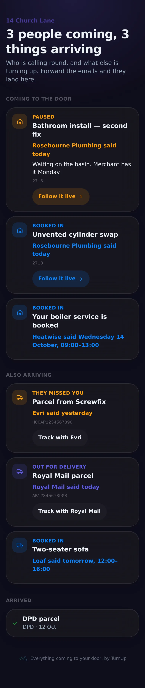

# v1.44.0 — Indigo

**2026-10-12** · background `#f5f5fc` · accent `#463a94`

- The dashboard's setup panels get the homepage treatment: a picture of the part instead of a paragraph about it. Who to expect shows the row the customer opens; Booking terms shows what they read and tap; Nudge me shows the two buzzes as they land on your lock screen, in the words actually sent; Turn on notifications shows the row it switches on; ServiceM8 shows Check In beside On site; the attendance record shows three rows of itself. Every one of them is shorter.

### wallet-in-stack

### wallet-opened

### wallet-alone

### customer-light

### customer-dark

### dashboard

### dashboard-setup

### login

### homepage

### homepage-dark

### household

### household-dark

