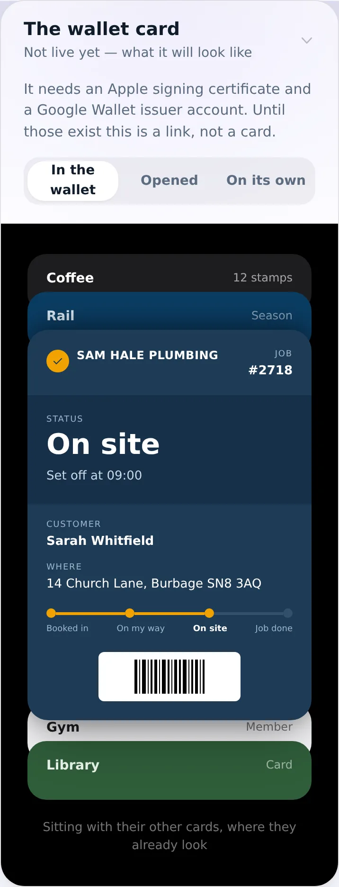
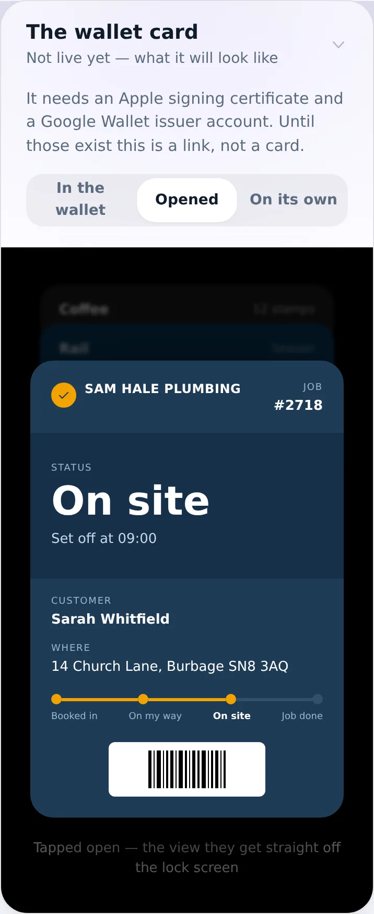
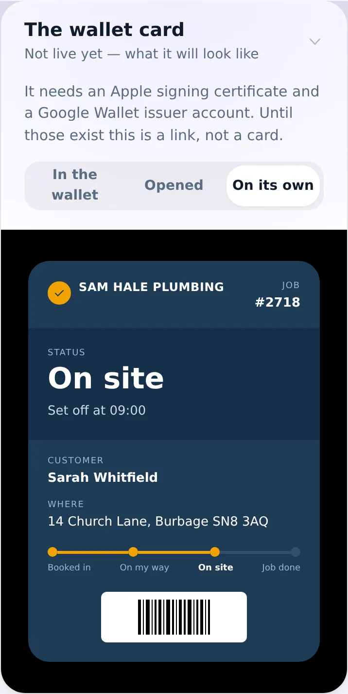
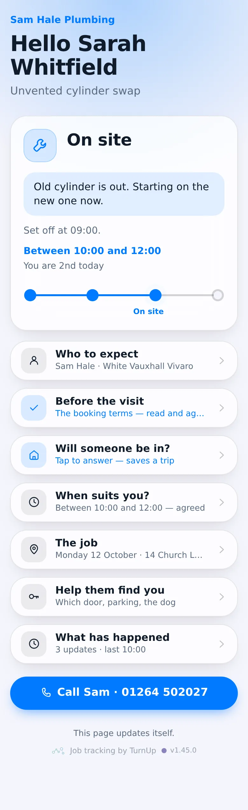
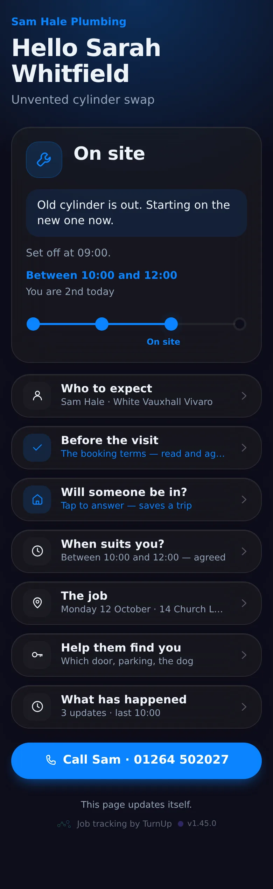
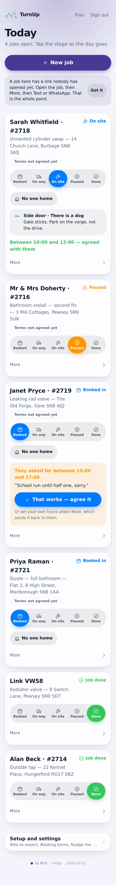
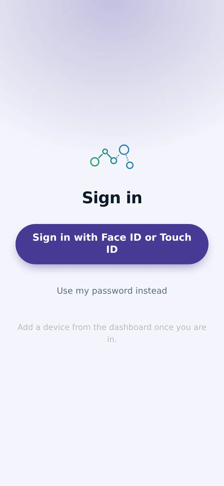

# v1.45.0 — Indigo

**2026-10-12** · background `#f5f5fc` · accent `#463a94`

- Switch link back on. A link switched off by mistake used to be dead and meant a new job; now Switch link back on sits where Switch link off was, under More, same size. A switched-off card says so in words — Link is off, the customer sees expired — rather than just going pale.

Not captured this time: the household card (set DEMO_PLACE to a seeded place code).

### wallet-in-stack

### wallet-opened

### wallet-alone

### customer-light

### customer-dark

### dashboard

### dashboard-setup

### login

### homepage

### homepage-dark

