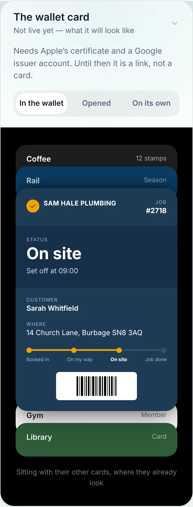
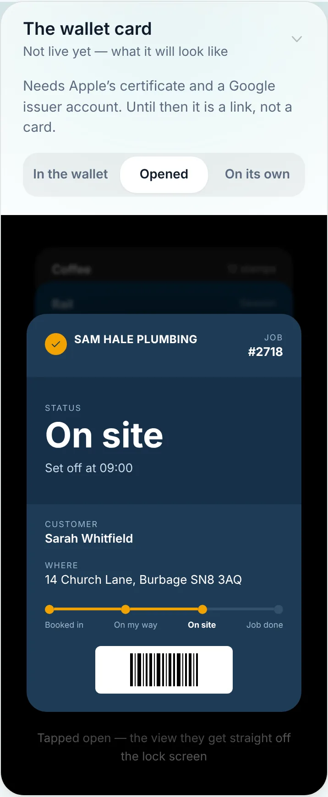
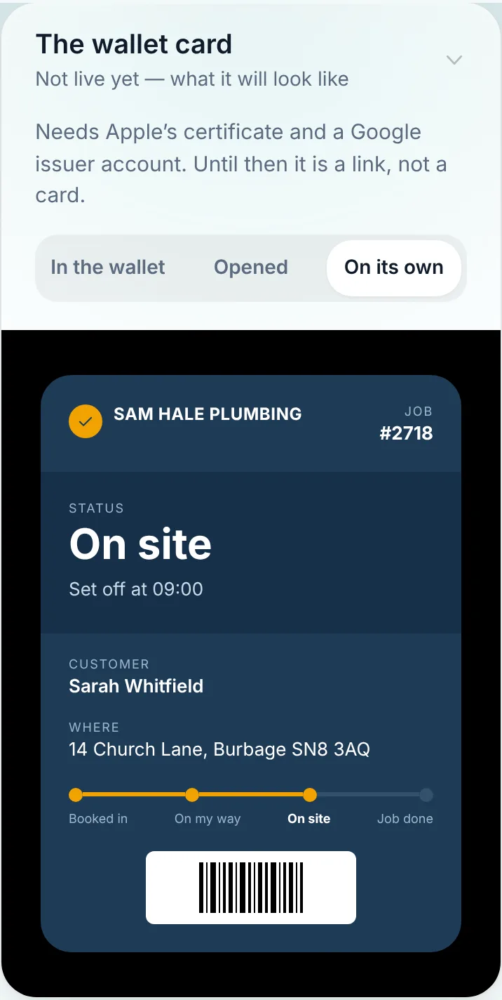
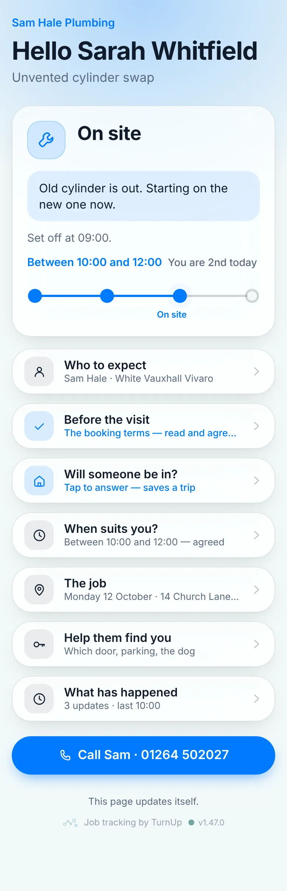
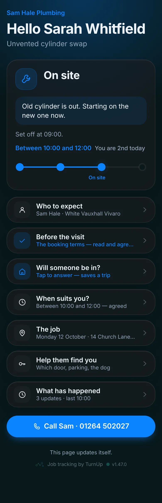
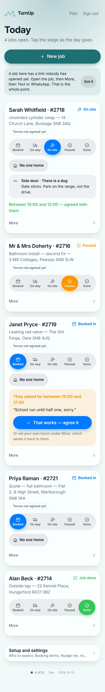
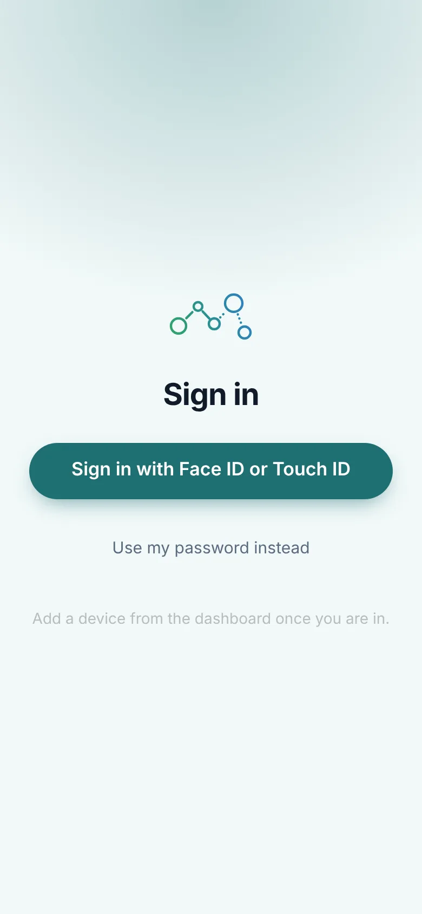

# v1.47.0 — Teal

**2026-10-12** · background `#f2f9f9` · accent `#1f6f72`

- The /j/ page, the one a customer lands on from the ServiceM8 text, drawn like the page it leads to: the glass, the wash, Booked in's blue, and under the four-digit box a picture of the card the digits unlock, so the person who just tapped a link can see what they are typing for. The words are shorter. The dead ends (no such job, still a quote, cancelled) say one line and show the number to ring.

### wallet-in-stack

### wallet-opened

### wallet-alone

### customer-light

### customer-dark

### dashboard

### dashboard-setup

### login

### homepage

### homepage-dark

### household

### household-dark

Note, added the same night: `household.webp` and `household-dark.webp` show "That card has
expired". The seeded card did not exist: `scripts/local-db.sh` had run against a stale
Prisma client, so the seed skipped the Place table and said so only in a line nobody
read. The same shot in v1.44.0 has the same cause. The v1.51.0 folder has the card.
