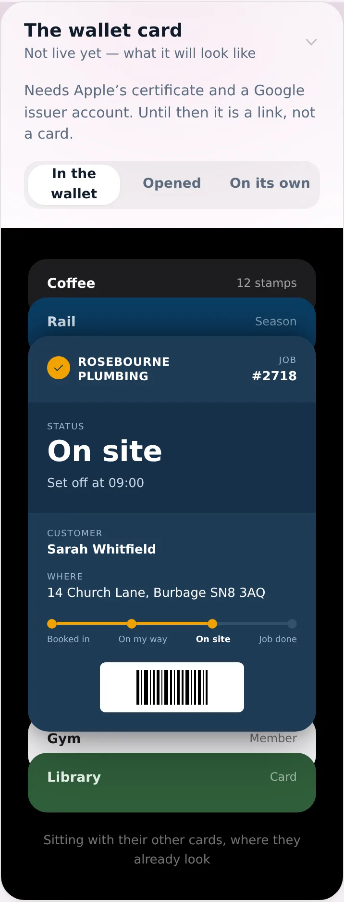
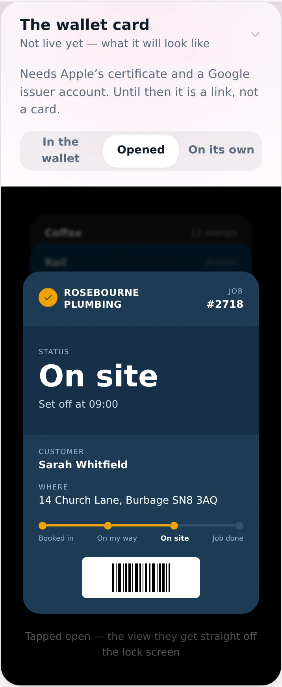
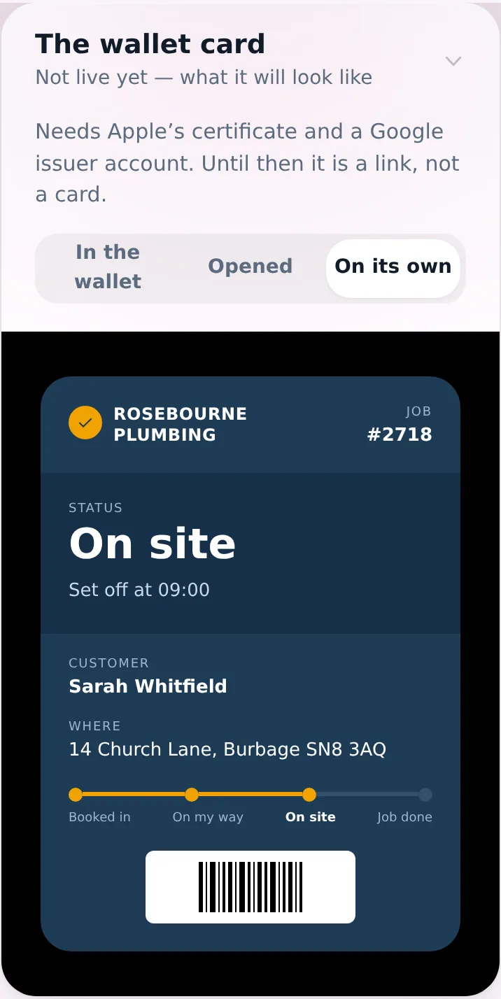
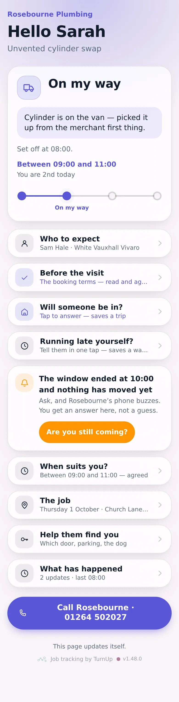
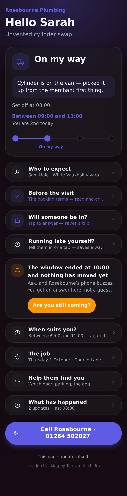
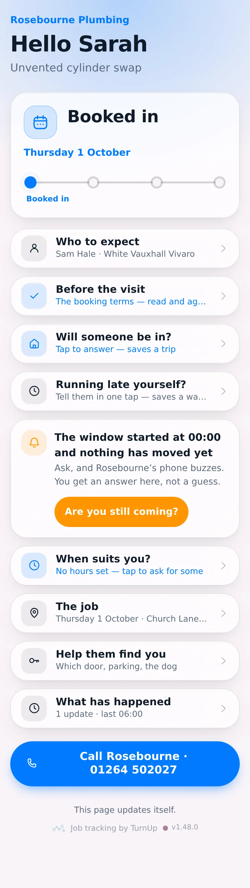
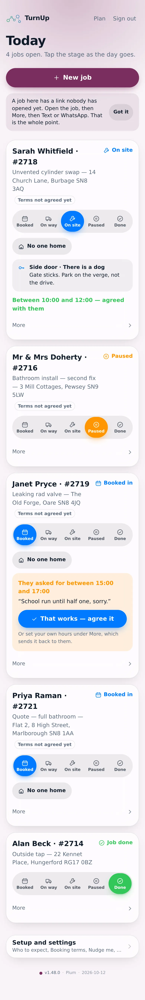
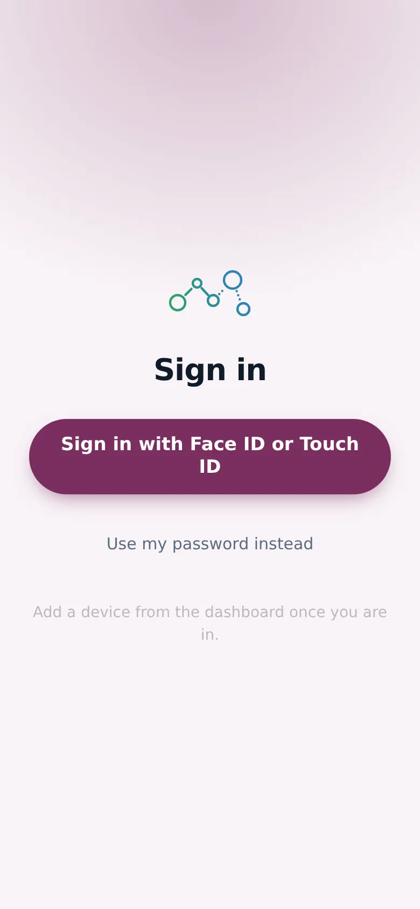
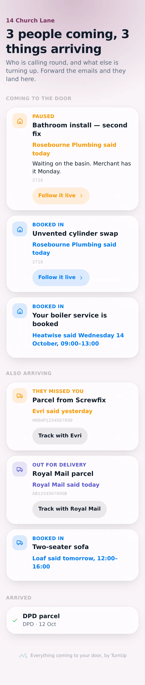
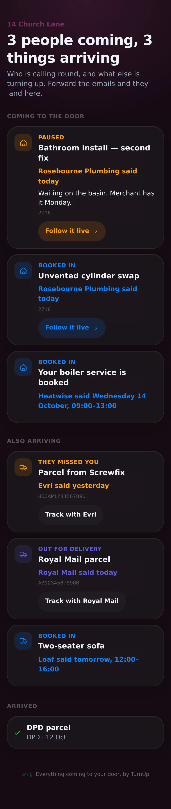

# v1.48.0 — Plum

**2026-10-12** · background `#f9f4f8` · accent `#7a2f5e`

- The household card tells a person from a parcel. Who is calling round comes first, under Coming to the door — your visit, the boiler engineer, the surveyor, the kitchen fitter. Everything that just lands sits under Also arriving. Nobody waits in for a jiffy bag and everybody waits in for an engineer, and one undifferentiated list made the reader do that sorting every time they opened it.
- The parser learned the difference. An email with a carrier or a tracking number is a parcel; one that says an engineer, surveyor, fitter or installer will attend is a person; a sofa with two men is goods with a crew. A boiler service and a window survey were both being dropped entirely before this, because no delivery phrase matched the way those senders write.
- Your own jobs go on a card and stay in step. Pick one from the dashboard under Household cards and it follows every stage you tap — On their way, Here now, Paused and why, Finished — including backwards, because a trade un-pausing a job is a fact and a carrier emailing out of order is not. Taking it off the card leaves the job untouched.
- Added by hand on purpose, never matched on address: two flats share a postcode, and a card is a link anyone can forward.

### wallet-in-stack

### wallet-opened

### wallet-alone

### customer-light

### customer-dark

### customer-booked

### dashboard

### dashboard-setup

### login

### homepage

### homepage-dark

### household

### household-dark

