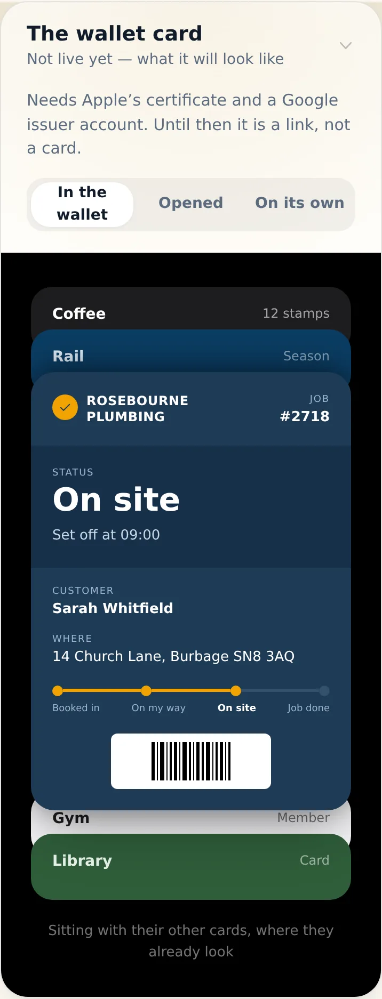
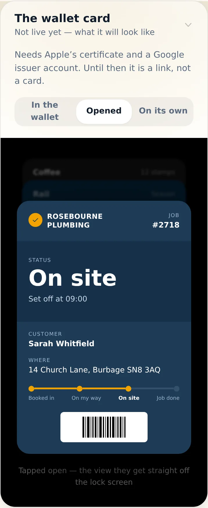
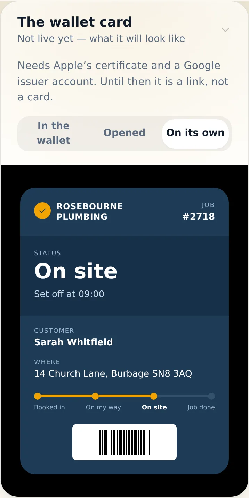
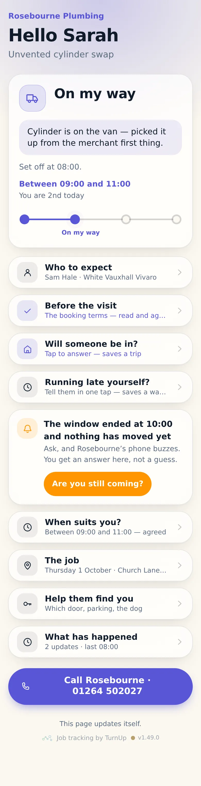
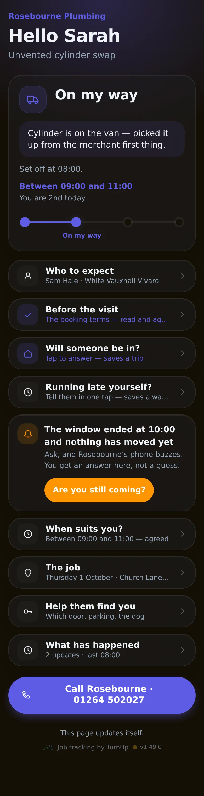
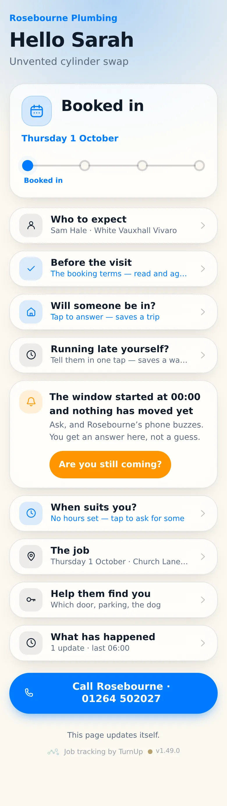
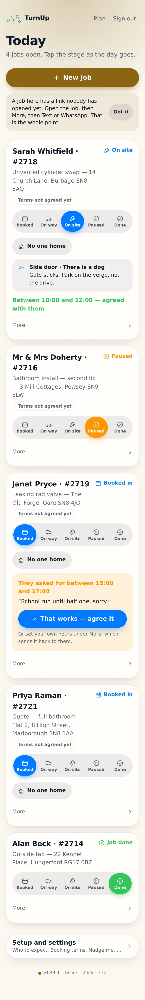
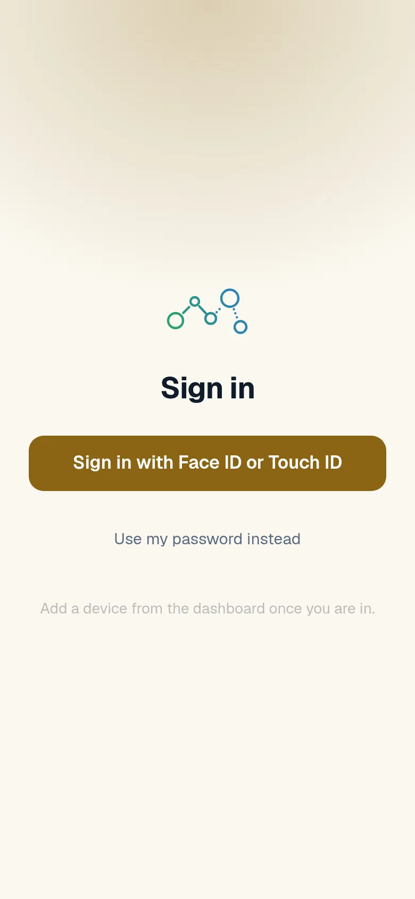
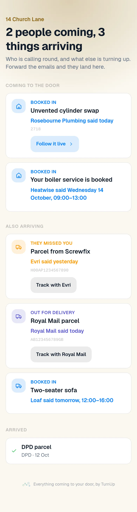
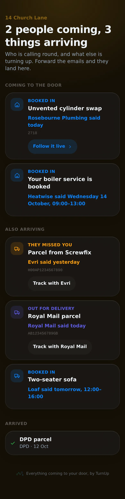

# v1.49.0 — Ochre

**2026-10-12** · background `#fbf8f0` · accent `#8a6414`

- The letterbox. Turn on forwarding, under Setup and settings, is the four steps that make a forwarded delivery email land on a household card — the password made on your own phone and sent nowhere, then Vercel, then Cloudflare, then the Worker, each with the link to press and what you will see when it worked. It disappears the moment forwarding is on, like the push one.
- The Cloudflare Email Worker is written and in the repo, and it does almost nothing on purpose: it reads the raw message and posts it. Fifteen lines, no dependencies, and it never throws — a thrown Email Worker bounces the mail back to the carrier.
- Which means the fiddly half lives here, under test. src/lib/mime.js turns a raw email into four facts: quoted-printable, base64, multipart with the plain part preferred over the HTML one, an HTML-only sender, encoded subject lines, and a pound sign that is a pound sign and not mojibake. The card inbox is read from Delivered-To, never from To, because a forwarded email’s To is whoever it was sent to in the first place.
- Checked on a subdomain rather than guessed: Cloudflare routes in.getturnup.com if the subdomain is added from the main domain’s Settings page, which leaves your own email at getturnup.com untouched, now and later.

### wallet-in-stack

### wallet-opened

### wallet-alone

### customer-light

### customer-dark

### customer-booked

### dashboard

### dashboard-setup

### login

### homepage

### homepage-dark

### household

### household-dark

