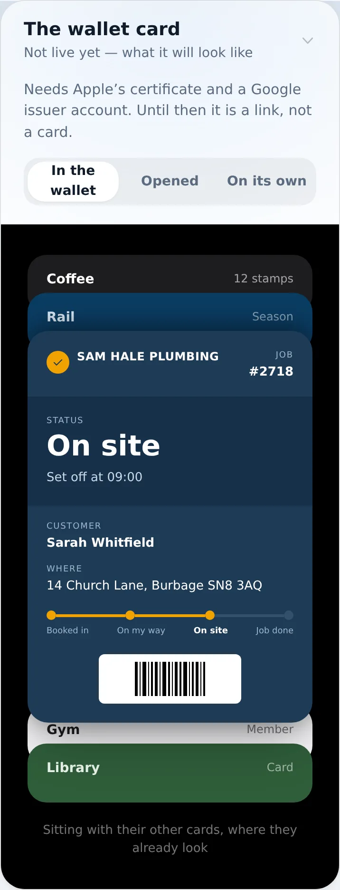
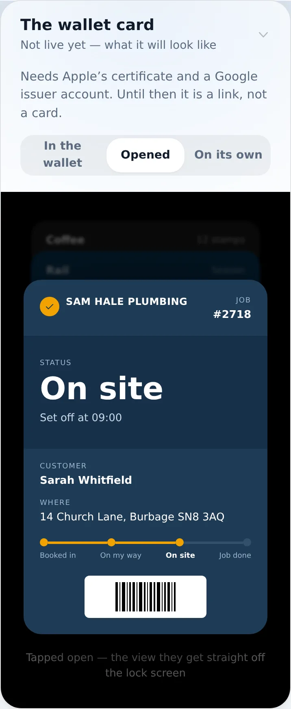
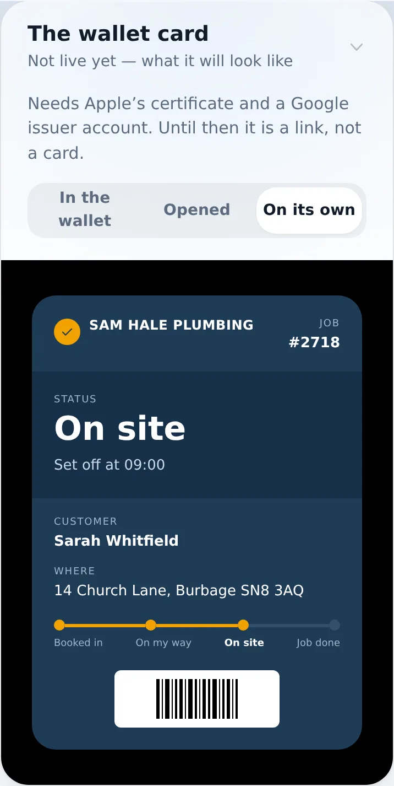
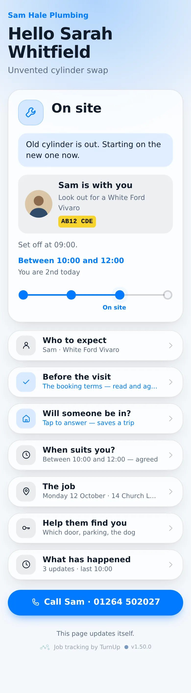
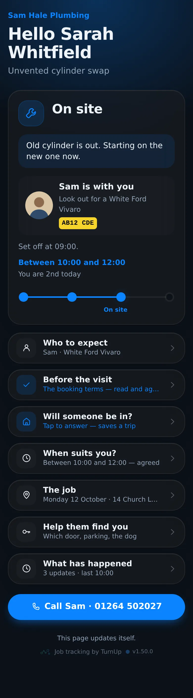
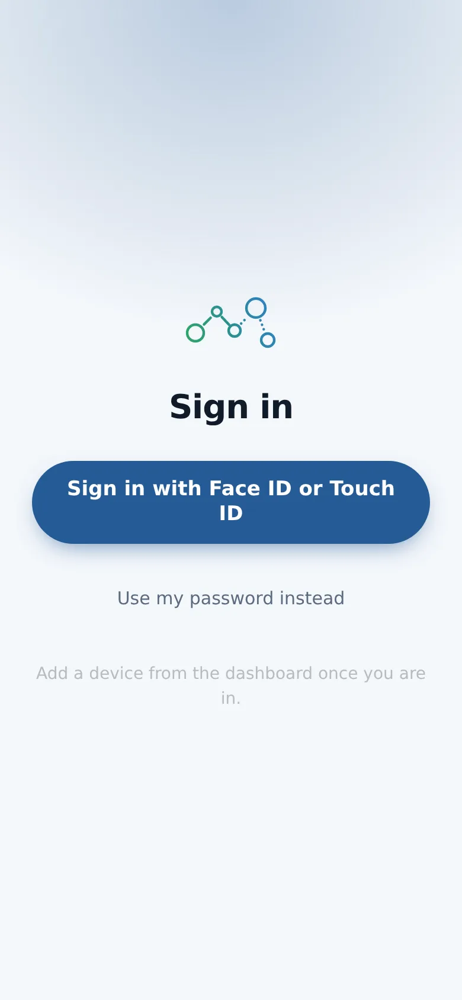

# v1.50.0 — Harbour

**2026-10-12** · background `#f4f7fb` · accent `#255a95`

- Who is coming, with a face. Under Who to expect, Take or choose a photo opens the phone camera, squares the picture off on the phone and keeps it at 512 pixels, so nothing is pasted and nothing large is sent. The moment you tap On my way the customer's card shows your face, your name, the van and the plate; at On site it reads is with you. Before that, nothing, as before.
- The On-my-way notification now says who: Sam Hale is on the way, from Sam Hale Plumbing, look out for a White Vauxhall Vivaro, AB12 CDE, with the face as the icon where the phone shows one. The photo is served from the app itself, never pasted from a link, and Remove takes it down everywhere at once.

Not captured this time: the household card (set DEMO_PLACE to a seeded place code).

### wallet-in-stack

### wallet-opened

### wallet-alone

### customer-light

### customer-dark

### dashboard

### dashboard-setup

### login

### homepage

### homepage-dark

