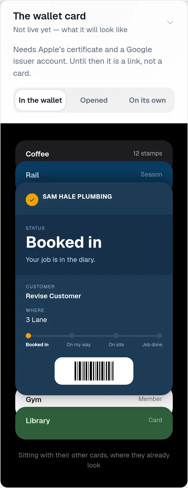
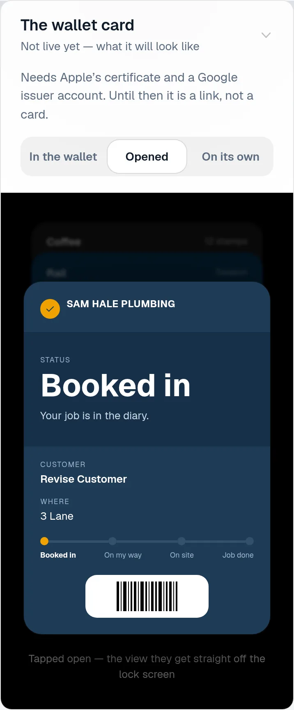
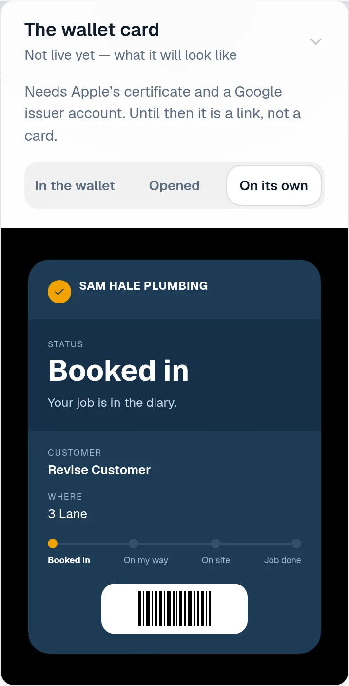
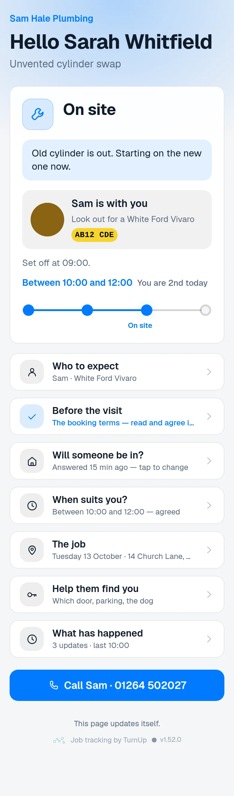
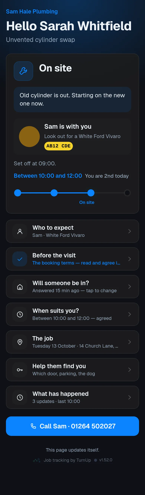

# v1.52.0 — Slate

**2026-10-13** · background `#f5f6f8` · accent `#44506b`

- A revised promise is shown as revised, and the original is kept. Move the hours and the customer's page says Revised 10:02, they first said between 09:00 and 11:00; agree their counter and it says changed at your request; withdraw the hours and it says so, with the day standing. Move the day and Booked for says which day it was first. Nobody is told the new time was always the time.
- Every change is a line in the record: Hours changed from between 09:00 and 11:00 to between 14:00 and 16:00, Moved from Tuesday 13 October to Wednesday 14 October, in ServiceM8 or on the dashboard alike. The dashboard shows the same words under the window, so you know what they are reading. The first hours are written once and never overwritten; scripts/check-public-shape.mjs proves a customer's counter can never become them.

Not captured this time: the household card (set DEMO_PLACE to a seeded place code).

### wallet-in-stack

### wallet-opened

### wallet-alone

### customer-light

### customer-dark

### dashboard

### dashboard-setup

### login

### homepage

### homepage-dark

