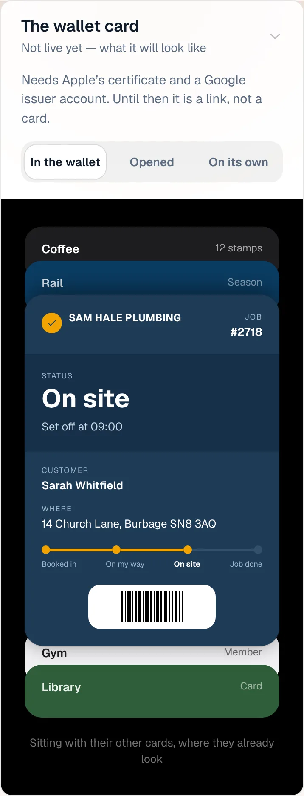
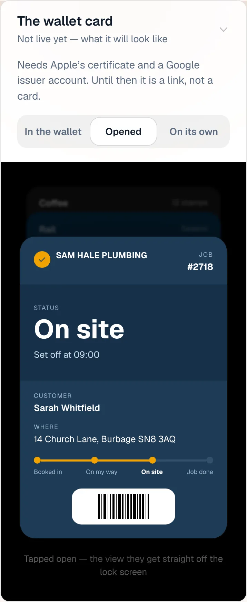
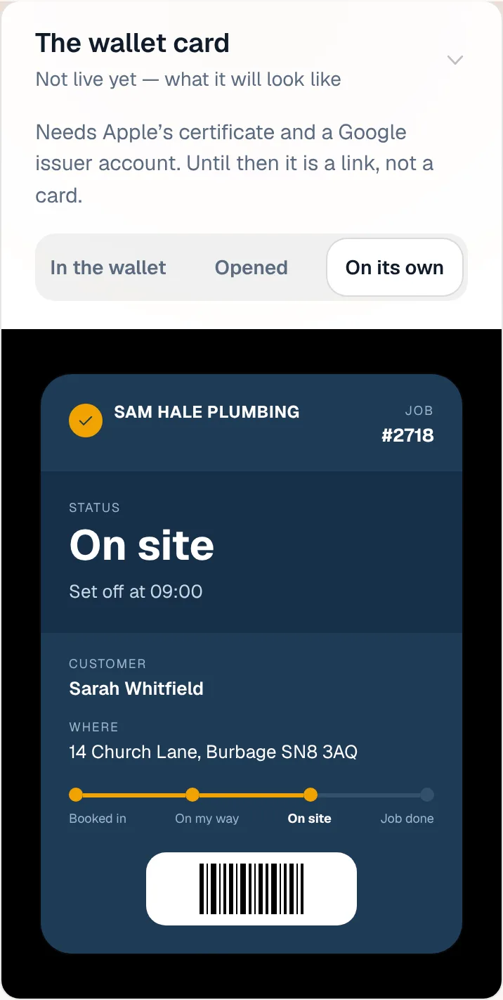
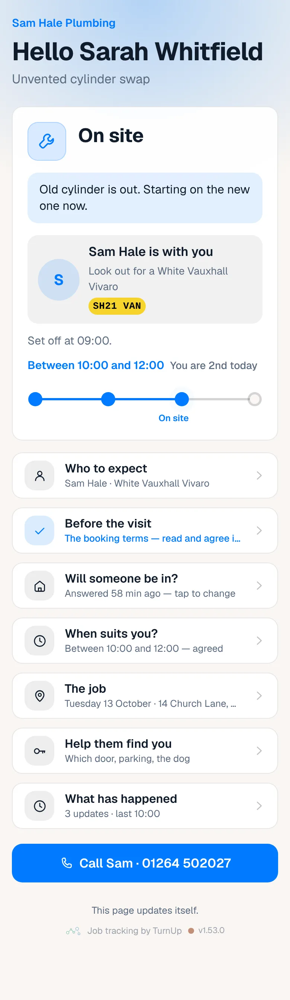
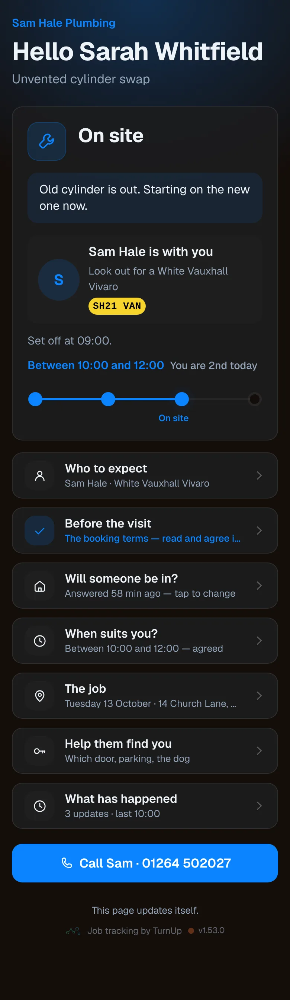
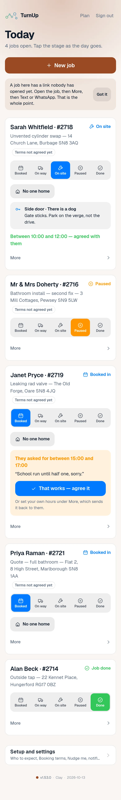
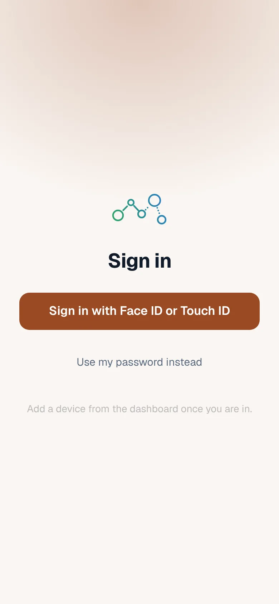
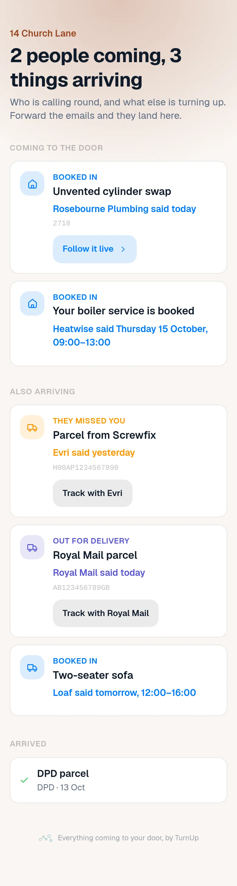
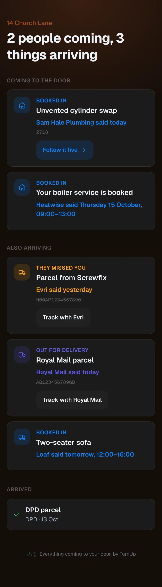

# v1.53.0 — Clay

**2026-10-13** · background `#faf6f2` · accent `#9a4a24`

- The household card says less and shows more. The sentence under the heading is gone: the rows say what they are. An empty card shows one example row, drawn with the real row, so a household can see what forwarding a delivery email does before they have done it. On the dashboard, Household cards shows the card itself instead of describing it, and its small print is one line.
- Fixed in the local seed: the household card was never created when the Prisma client was stale, so three diaries photographed a card that said it had expired. The seed now says so when it happens.

### wallet-in-stack

### wallet-opened

### wallet-alone

### customer-light

### customer-dark

### dashboard

### dashboard-setup

### login

### homepage

### homepage-dark

### household

### household-dark

