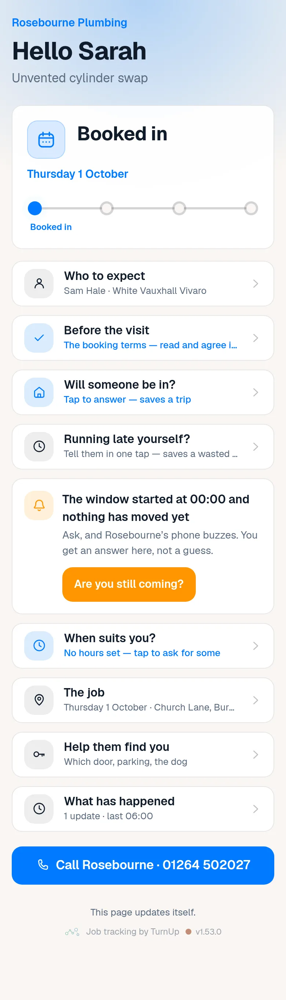

# v1.53.0 — Clay

**2026-10-13** · background `#faf6f2` · accent `#9a4a24`

- Turning forwarding on is one button and two Cloudflare steps. It was four steps and two of them needed a laptop — an environment variable in Vercel plus a redeploy, and a Worker deployed with a terminal. Asked twice more to just set it up, which is the same signal as the push script being run none of the four times it was asked for, so two steps were deleted rather than explained again.
- Switch it on writes the password itself, to a row, so there is no Vercel visit and nothing to redeploy. The environment variable still wins wherever it is set.
- And the Worker is handed over finished, with the address and the password already in it, to paste into Cloudflare’s own editor in a browser. Pressing the button twice keeps the same password rather than quietly stranding a Worker that is already deployed.
- What is left is a Cloudflare account and a nameserver change. Nothing can delete those: one is an account somebody has to own, the other is a domain somebody has to prove they control.

### wallet-in-stack

### wallet-opened

### wallet-alone

### customer-light

### customer-dark

### customer-booked

### dashboard

### dashboard-setup

### login

### homepage

### homepage-dark

### household

### household-dark

