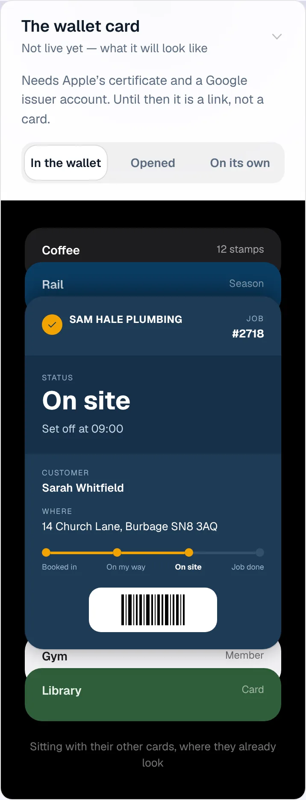
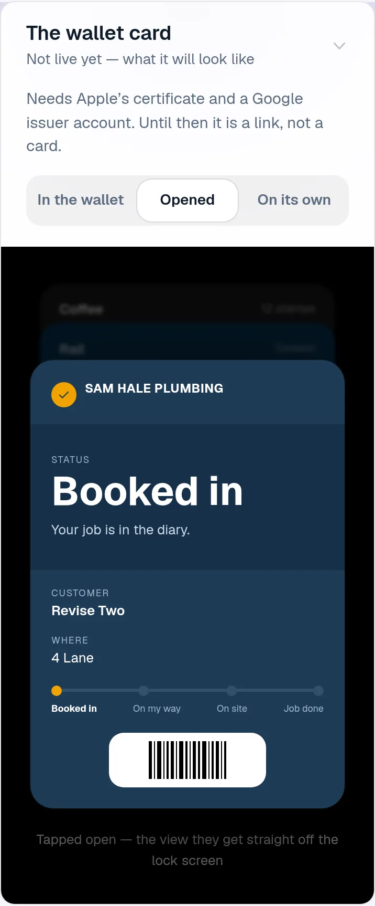
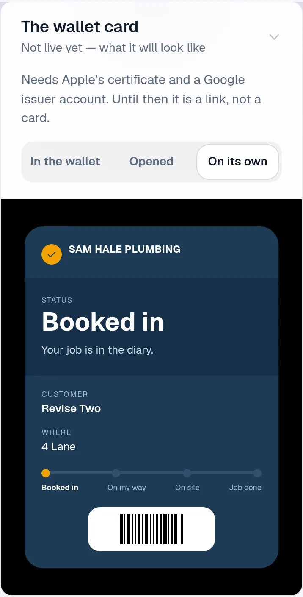
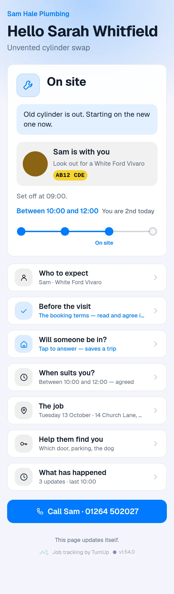
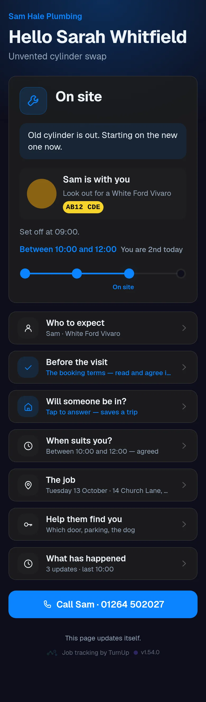
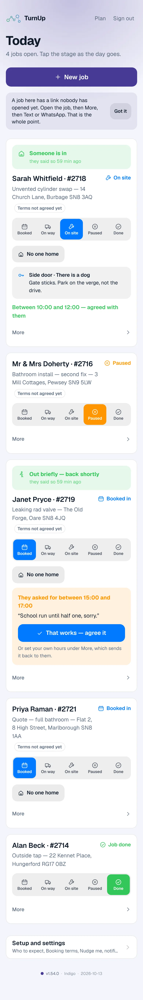

# v1.54.0 — Indigo

**2026-10-13** · background `#f5f5fc` · accent `#463a94`

- Paused says when you expect to be back. Tap Paused and the card asks: 30 min, 1 hour, 2 hours, after lunch, later today, tomorrow, another day. The customer's page reads Paused at 10:40 and Sam says: back in about an hour, said at 10:40 — your words, with the time you said them, never a time the product worked out. Once the hour has gone it says that was 11:40, still paused, taking longer than they thought, rather than keep promising.
- One tap goes to the four places about 30 minutes late already goes: the card, a push to the customer, the record, and the ServiceM8 diary. Leaving Paused clears it. Tomorrow and another day carry no clock time at all; the hours for that come under When suits you? like any other window.

Not captured this time: the household card (set DEMO_PLACE to a seeded place code).

### wallet-in-stack

### wallet-opened

### wallet-alone

### customer-light

### customer-dark

### dashboard

### dashboard-setup

### login

### homepage

### homepage-dark

