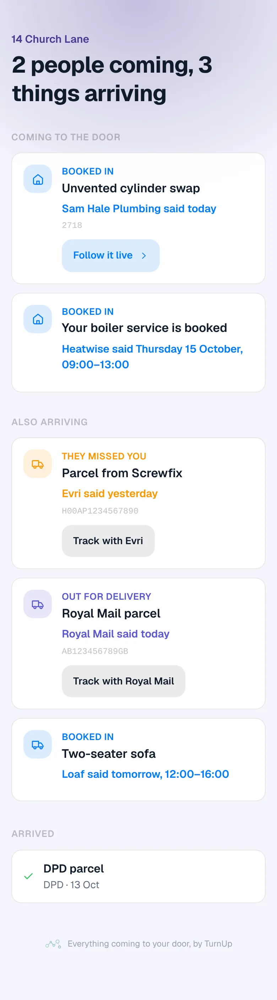
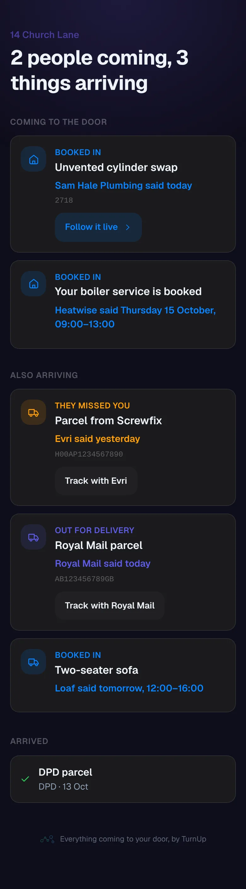

# v1.54.0 — Indigo

**2026-10-13** · background `#f5f5fc` · accent `#463a94`

- The review link, in pictures. Under Who to expect, the Google review field now sits beneath the row every customer sees after Job done, so the link has a visible reason; the hint is only the three steps to get it. On the customer's page, How did it go? says one line: a review helps most, a note reaches the trade alone. The preview fixture carries a review link at DONE, so that row can be photographed.

### wallet-in-stack

### wallet-opened

### wallet-alone

### customer-light

### customer-dark

### dashboard

### dashboard-setup

### login

### homepage

### homepage-dark

### household

### household-dark

