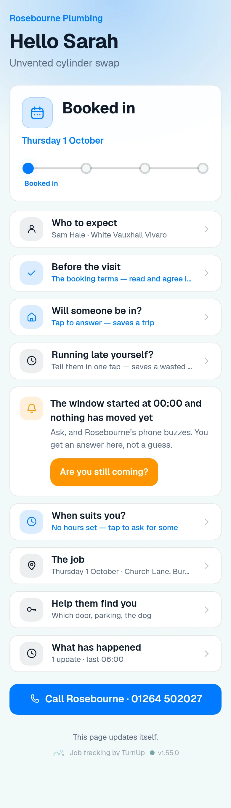

# v1.55.0 — Teal

**2026-10-14** · background `#f2f9f9` · accent `#1f6f72`

- Turn on forwarding says where it has got to, and checks itself every twenty seconds. Switched on here, the domain is on Cloudflare, mail points at Cloudflare, something has arrived — each one asked of the internet rather than assumed, so setting this up stops being four things done blind in four different websites.
- Asked of two DNS-over-HTTPS resolvers, not the server’s own, which in the container this was written in answered ENODATA for records that plainly exist. A step somebody HAS done must never be drawn with a cross because a lookup failed, so unknown is its own state and draws the same empty circle as not-yet.
- Something has arrived is a demonstration, not a claim: it counts what actually reached the letterbox and says what became of the last one — filed as OUT_FOR_DELIVERY, not an arrival, or arrived but no card address in it. Those are three different problems with three different fixes, and before this they all looked like silence.
- The nameserver half is written out as a Cowork job in docs/cowork-nameservers.md, per the standing rule that clicking through a console is a paste, not a step list.

### wallet-in-stack

### wallet-opened

### wallet-alone

### customer-light

### customer-dark

### customer-booked

### dashboard

### dashboard-setup

### login

### homepage

### homepage-dark

### household

### household-dark

