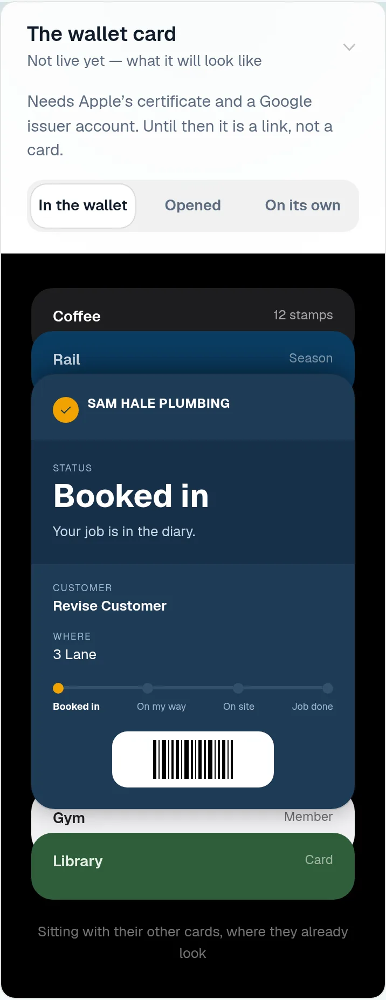
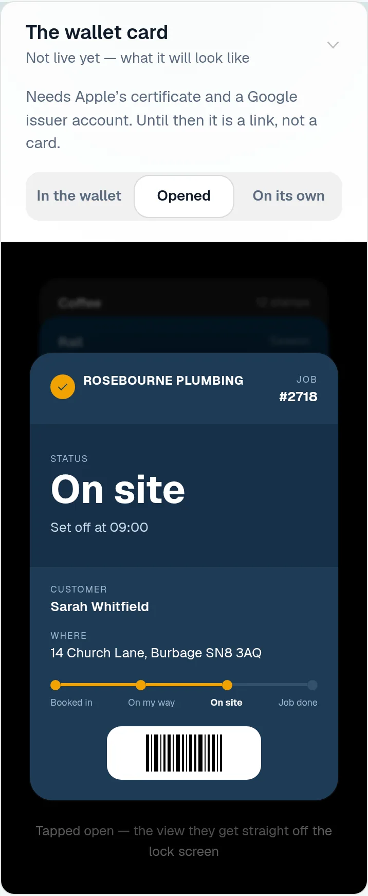
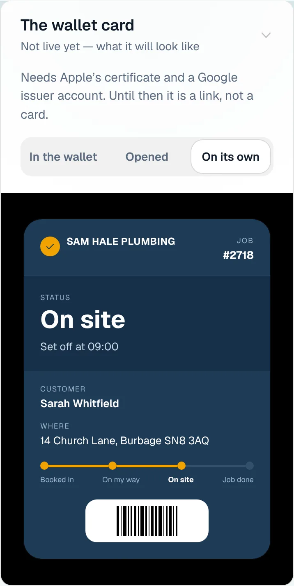
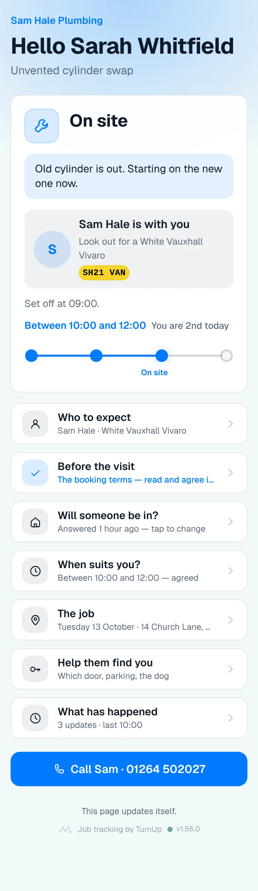
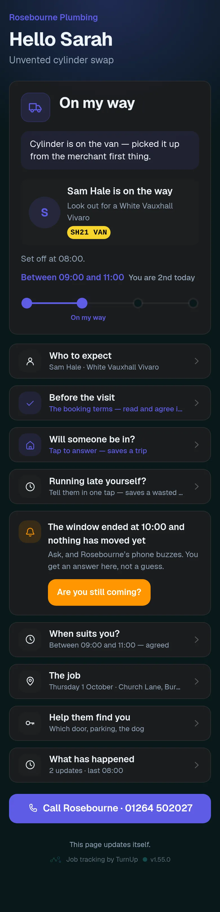
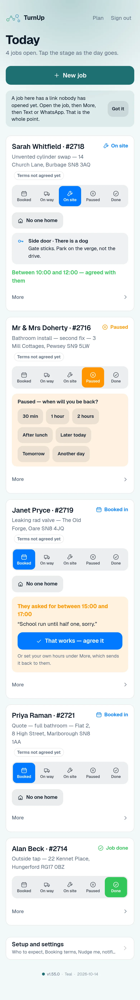
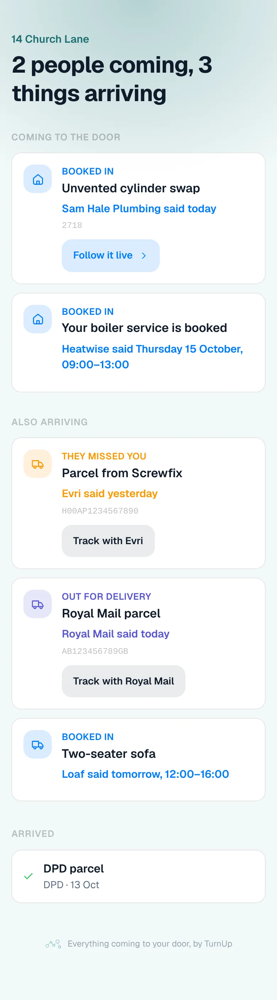
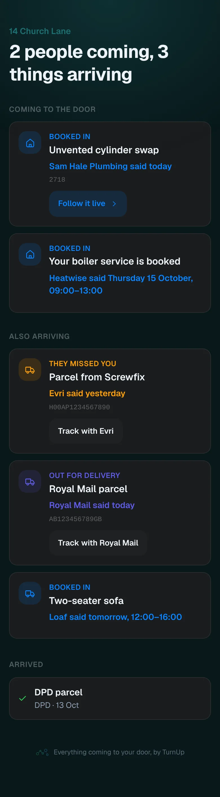

# v1.55.0 — Teal

**2026-10-13** · background `#f2f9f9` · accent `#1f6f72`

- What this could become, in pictures. Every item that has a screen shows it: the homepage frames for the ideas and the live things, the setup panels' crops for the rest. A row is a picture, a name and a chip; tap the name for the sentence and what it needs. The live list is folded behind its count and a strip of its screens, because the panel is for the things not built yet. The votes work as before.

### wallet-in-stack

### wallet-opened

### wallet-alone

### customer-light

### customer-dark

### dashboard

### dashboard-setup

### login

### homepage

### homepage-dark

### household

### household-dark

